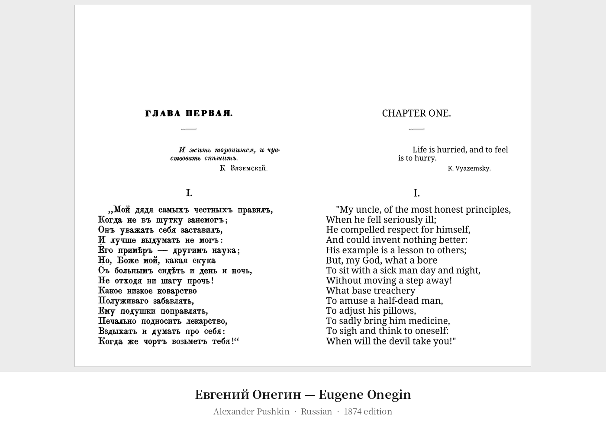

# PDF Translator

> Layout-preserving PDF translation via LLM — side-by-side bilingual or full substitution, any language pair.

[](https://python.org)
[](https://docs.litellm.ai)
[](https://pymupdf.readthedocs.io)

<p align="center">
  <b><code>--mode side-by-side</code></b><br>
  
</p>

<p align="center">
  <b><code>--mode substitute</code></b><br>
  
</p>

<p align="center"><sub>
Real output, one page per document, translated to English with the default model.
Sources: <a href="https://archive.org/details/pushkin-evgeny-onegin-.-1874-bmk-brz">Pushkin</a> ·
<a href="https://messervices.cyber.gouv.fr/guides/recommandations-de-securite-pour-un-systeme-dia-generative">ANSSI</a> ·
<a href="https://archive.org/details/nicolaicopernici00cope_1">Copernicus</a> ·
<a href="https://www.soumu.go.jp/main_content/001064299.pdf">MIC/METI</a> ·
<a href="https://archive.org/details/fausteinetragd00goetuoft">Goethe</a> ·
<a href="http://www.caict.ac.cn/kxyj/qwfb/bps/201812/P020181227308307634492.pdf">CAICT</a> ·
<a href="https://archive.org/details/sidereusnunciusm00gali_0">Galileo</a> ·
<a href="https://www.bundesarchiv.de/im-archiv-recherchieren/stasi-unterlagen-einsehen/hinweise-zum-mfs/die-grundsatzdokumente-des-ministeriums-fuer-staatssicherheit/">Bundesarchiv (Stasi)</a> ·
<a href="https://archive.org/details/ilprincipemach00machuoft">Machiavelli</a>.
Rebuild with <code>uv run --with pillow python utilities/make_readme_gifs.py</code>.
</sub></p>

---

## Table of Contents

- [Features](#features)
- [How It Works](#how-it-works)
- [Install](#install)
- [Quick Start](#quick-start)
- [Providers](#providers)
- [CLI Reference](#cli-reference)
- [Configuration](#configuration)
- [Output Modes](#output-modes)
- [Architecture](#architecture)
- [Known Limitations](#known-limitations)
- [Project Layout](#project-layout)

---

## Features

- ✅ **Any LLM provider** — works with OpenRouter, Anthropic, OpenAI, Google Gemini, Groq, Together.ai, xAI, Ollama, LM Studio, and any other [LiteLLM-supported provider](https://docs.litellm.ai/docs/providers)
- ✅ **Any language pair** — source and target language are model-dependent; modern LLMs cover 50+ languages
- ✅ **Layout preserved** — images, rules, backgrounds, page numbers and all non-text elements survive untouched
- ✅ **Side-by-side bilingual output** — original on the left, translation on the right; ideal as a reading or language-learning aid
- ✅ **Full substitution mode** — translation only, typeset at the original baseline and alignment
- ✅ **Smart font matching** — bundled Noto Sans/Serif (Latin, Cyrillic, Greek); serif/sans-serif automatically matched per line
- ✅ **Disk cache** — completed page translations are cached; interrupted runs resume from where they left off with no extra API cost
- ✅ **Automatic repair** — lines the model echoes unchanged are detected and retried; missing lines fall back to per-line translation
- ✅ **Page range selection** — process any subset of pages (`1-5,7,20-30`)

---

## How It Works

The translator works in three stages per page:

1. **Scan** — PyMuPDF extracts every text span; fragments sharing a baseline are re-merged into visual lines; page numbers and other non-body elements are frozen.
2. **Translate** — all lines on the page are sent to the LLM as a single keyed JSON batch so the model has full-page context. The key scheme (`"0"` … `"N"`) aligns responses even if the model re-orders or skips lines. Missing lines fall back to per-line calls; echoed lines are repaired.
3. **Render** — the original page is stamped as the base layer; each translated line gets an opaque background-coloured mask over the source text, then the translation is drawn at the original baseline and alignment.

This means **everything not explicitly translated is preserved for free** — no image reconstruction, no per-element layout parsing.

---

## Install

Requires Python 3.11+ (the floor is set by litellm, which needs `typing.NotRequired`).

```bash
uv pip install -e .
```

An API key is only required for cloud providers. Local providers (Ollama, LM Studio) need no key at all. See [Providers](#providers) for setup per provider.

---

## Quick Start

```bash
# Side-by-side bilingual PDF, pages 1–40, Lithuanian → English (default provider: OpenRouter)
export OPENROUTER_API_KEY="sk-or-v1-..."
pdf-translate -i "book.pdf" -o "book-en.pdf" -t English -p 1-40

# Full substitution (translation only)
pdf-translate -i "book.pdf" -o "book-en.pdf" -t English --mode substitute

# Specific page ranges (comma-separated)
pdf-translate -i "book.pdf" -o "book-en.pdf" -t Spanish -p 5-8,12,20-25

# Re-translate specific pages, discarding only their cache entries
pdf-translate -i "book.pdf" -o "book-en.pdf" -t German -p 10,13,17 --ignore-cache
```

---

## Providers

The translator uses [LiteLLM](https://docs.litellm.ai/docs/providers) under the hood, which means it works with any provider LiteLLM supports. Set the appropriate environment variable for your provider and pass the matching `--model` string. No `--api-key` flag needed — LiteLLM reads the provider's own env var automatically.

### OpenRouter *(default — routes to any model)*

```bash
export OPENROUTER_API_KEY="sk-or-v1-..."

# Default (fast + cheap)
pdf-translate -i book.pdf -o out.pdf -m openrouter/google/gemini-2.5-flash-lite

# Higher quality
pdf-translate -i book.pdf -o out.pdf -m openrouter/anthropic/claude-sonnet-4-5
pdf-translate -i book.pdf -o out.pdf -m openrouter/openai/gpt-4o
```

### Anthropic (Claude)

```bash
export ANTHROPIC_API_KEY="sk-ant-..."

pdf-translate -i book.pdf -o out.pdf -m anthropic/claude-haiku-4-5-20251001
pdf-translate -i book.pdf -o out.pdf -m anthropic/claude-sonnet-4-6
```

### OpenAI

```bash
export OPENAI_API_KEY="sk-..."

pdf-translate -i book.pdf -o out.pdf -m openai/gpt-4o-mini
pdf-translate -i book.pdf -o out.pdf -m openai/gpt-4o
```

### Google Gemini (direct)

```bash
export GEMINI_API_KEY="..."

pdf-translate -i book.pdf -o out.pdf -m gemini/gemini-2.0-flash
pdf-translate -i book.pdf -o out.pdf -m gemini/gemini-2.5-flash
```

### xAI (Grok)

```bash
export XAI_API_KEY="..."

pdf-translate -i book.pdf -o out.pdf -m xai/grok-2
```

### Groq

```bash
export GROQ_API_KEY="..."

pdf-translate -i book.pdf -o out.pdf -m groq/llama-3.3-70b-versatile
```

### Together.ai

```bash
export TOGETHER_API_KEY="..."

pdf-translate -i book.pdf -o out.pdf -m together_ai/meta-llama/Llama-3-70b-chat-hf
```

### Ollama *(local, no key required)*

```bash
# Start Ollama with your chosen model first:
# ollama pull llama3

pdf-translate -i book.pdf -o out.pdf -m ollama/llama3
pdf-translate -i book.pdf -o out.pdf -m ollama/mistral
```

LiteLLM connects to Ollama at `http://localhost:11434` by default. Override with `--api-base` if your Ollama runs elsewhere.

### LM Studio *(local, no key required)*

```bash
# Start LM Studio's local server first (default port 1234).
# The model name must match what LM Studio reports.

pdf-translate -i book.pdf -o out.pdf \
  -m openai/lmstudio-community/Meta-Llama-3-8B-Instruct-GGUF \
  --api-base http://localhost:1234/v1
```

---

## CLI Reference

```
pdf-translate [OPTIONS]

Options:
  -i, --input      PATH    Source PDF (required)
  -o, --output     PATH    Output PDF (required)
  -t, --target     TEXT    Target language  [default: English]
  -m, --model      TEXT    LiteLLM model string  [default: openrouter/google/gemini-2.5-flash-lite]
      --mode       TEXT    Output mode: side-by-side | substitute  [default: side-by-side]
  -p, --pages      TEXT    Page range, e.g. 1-5,7 or all  [default: all]
      --api-key    TEXT    API key override (usually not needed — set the provider env var instead)
      --api-base   TEXT    Provider base URL override (for local providers, e.g. http://localhost:1234/v1)
      --cache-dir  PATH    Translation cache directory  [default: .translation_cache]
      --ignore-cache       Re-translate the pages in --pages, overwriting their
                           cache entries (other pages are left untouched)
      --request-pause FLOAT  Seconds to wait before each API call  [default: 0]
      --max-tokens INT     Max tokens per model response  [default: 8192]
      --max-attempts INT   Attempts per API call before giving up  [default: 3]
  -v, --verbose            Debug logging
      --help               Show this message and exit
```

---

## Configuration

| Setting | Default | How to set |
|---------|---------|------------|
| Model | `openrouter/google/gemini-2.5-flash-lite` | `--model` |
| Target language | `English` | `--target` |
| Output mode | `side-by-side` | `--mode` |
| API key | *(provider env var)* | Provider env var (e.g. `OPENROUTER_API_KEY`) or `--api-key` to override |
| API base URL | *(provider default)* | `--api-base` (local providers only) |
| Cache directory | `.translation_cache/` | `--cache-dir` |
| Rate limiting | *(no pause)* | `--request-pause` |
| Response size | 8192 tokens | `--max-tokens` |
| Retry attempts | 3 | `--max-attempts` |

### Choosing a model

For most books, a fast, cheap model is indistinguishable from a premium one. Rough guidance:

| Use case | Suggested model |
|----------|----------------|
| General books, fast & cheap | `openrouter/google/gemini-2.5-flash-lite` |
| Technical / specialised vocabulary | `openai/gpt-4o` or `anthropic/claude-sonnet-4-6` |
| Fully offline / private | `ollama/llama3` or `ollama/mistral` |
| Free tier / no sign-up | `ollama/llama3` |

---

## Output Modes

### `side-by-side` (default)

The output page is twice the original width. The left half shows the original page; the right half shows the translated overlay. Useful for:
- Language learning (compare original and translation side by side)
- Reviewing translation accuracy
- Documents where you want to keep the source for reference

### `substitute`

The output page is the same size as the original. The translation is drawn directly over the source text. Useful for:
- Reading a book in the target language
- Sharing a translated document without the original

---

## Architecture

```
src/pdftranslator/
  cli.py            Typer entry point — argument parsing, wires components together
  orchestrator.py   Page loop, range parsing, cross-page context threading
  scanner.py        PyMuPDF extraction → baseline merging → frozen/translatable split
  translate.py      Keyed-batch LLM translation, sentinel padding, fallback, repair, cache
  render.py         Base-layer stamp + mask + in-place text overlay
  models.py         Span / Line / PageContent dataclasses
  fonts.py          Bundled Noto Sans/Serif + text-width measurement
  data/             Noto TTFs, packaged with the wheel
```

**Data flow:**

```
fitz.Page
  └─► DocumentScanner.extract()  →  PageContent (frozen_spans + lines[])
        └─► Translator.translate_page()  →  lines[].translated filled
              └─► PdfRenderer.render_page()  →  output page appended to writer
```

**Translation robustness pipeline** (per page):

```
1. Cache hit?  →  return immediately
2. Keyed-batch call (whole page, with sentinel padding)
   ├─ All N keys present?  →  done
   └─ Missing keys?  →  per-line fallback for each missing key
3. Repair pass: lines returned unchanged?  →  retry per-line
4. Final safety net: still None?  →  keep source text
5. Cache result
```

---

## Known Limitations

### Rendering

| Issue | Status |
|-------|--------|
| Translated lines are ragged-right (not re-justified) | Planned: word-spacing fill to match original column width |
| Long translations shrink font size to fit | By design (no overflow/collision); one factor per page, so relative sizes are preserved |
| Background mask is flat colour | Works well on solid pages; visible over photos/gradients |
| Multi-column layouts and tables | Single text-column assumed; columns may merge |
| Bold / italic not reproduced | Only Noto Regular bundled; per-span weight/style is planned |
| Scanned pages without a text layer | Copied as-is (no OCR) |
| Non-Latin targets (CJK, Arabic, etc.) | Needs matching Noto font variants |

### Translation quality

| Issue | Status |
|-------|--------|
| Running headers translate inconsistently across pages | Planned: detect recurring lines, translate once |
| Mixed-script residue (proper names, discussed foreign words) | Conservative by design to avoid damaging correct cases |
| Stylised logos OCR as noise | Graphics-only elements; a logo-freeze heuristic is planned |

---

## Project Layout

```
PDFTranslator/
├── src/pdftranslator/
│   ├── cli.py            Entry point
│   ├── orchestrator.py   Page loop
│   ├── scanner.py        Text extraction
│   ├── translate.py      LLM translation + cache
│   ├── render.py         PDF rendering
│   ├── models.py         Data models
│   ├── fonts.py          Font management
│   └── data/             Bundled Noto fonts (shipped inside the wheel)
│       ├── NotoSans-Regular.ttf   Latin/Cyrillic/Greek sans-serif
│       └── NotoSerif-Regular.ttf  Latin/Cyrillic/Greek serif
├── tests/
├── utilities/            Demo tooling: fetch source PDFs (ia_get.py), find pages,
│                         build the README GIFs (make_readme_gifs.py)
├── corpus/               Downloaded source PDFs (gitignored)
├── docs/images/          README demo GIFs
├── pyproject.toml
└── README.md
```
